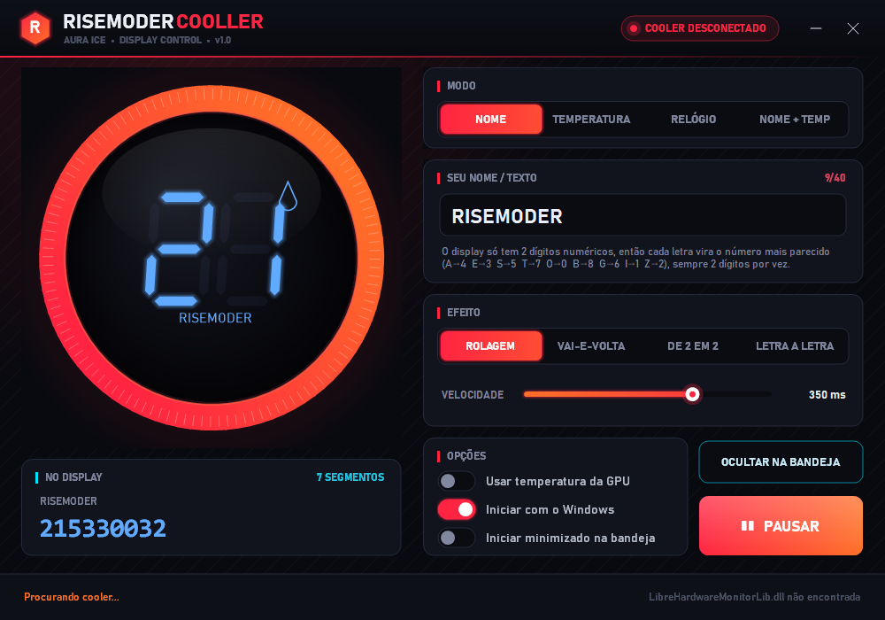

# WATER COOLER AURA ICE BLACK 120MM ARGB

**RiseModer Cooller** — software independente para o display do water cooler **Rise Mode Aura Ice ARGB (RM-WAIB-04-ARGB)**.
Em vez de mostrar só a temperatura, o display mostra **seu nome deslizando**, a **hora**, ou alterna **nome + temperatura**.



## Funcionalidades

- **Modo Nome**: seu texto desliza pelo display de 2 dígitos
  - efeitos: Rolagem, Vai-e-volta, De 2 em 2, Letra a letra
  - velocidade ajustável
- **Modo Temperatura**: temperatura da CPU ou da GPU
- **Modo Relógio**: alterna hora e minutos
- **Modo Nome + Temp**: o nome passa uma vez, depois mostra a temperatura por alguns segundos
- Pré-visualização animada do cooler na tela
- Fica na bandeja do Windows e pode iniciar junto com o Windows
- Instalador próprio, com desinstalador em *Configurações > Aplicativos*

## Instalação

Baixe o `RiseModerCooller-Setup.exe` na página de [Releases](../../releases/latest) e execute (pede administrador).

> O software original do fabricante usa o display em modo exclusivo, então os dois não funcionam juntos.
> Se ele estiver instalado, o instalador (e o próprio app ao abrir) oferece desinstalá-lo.

Para o modo **Temperatura** é preciso o driver [PawnIO](https://pawnio.eu) instalado.
Os modos Nome e Relógio funcionam sem ele.

### ⚠️ "O controle inteligente de aplicativos bloqueou um aplicativo"

O RiseModer Cooller é um projeto open-source **sem assinatura digital** (certificados de assinatura de código são pagos).
Por isso o **Controle Inteligente de Aplicativos** (*Smart App Control*) do Windows 11 e o **SmartScreen**
podem bloquear o instalador ou o programa, avisando que "não conseguimos verificar seu fornecedor".

Isso **não significa que o arquivo tem vírus**: o Windows só bloqueia programas novos que ainda não têm reputação.
Todo o código está aqui no repositório e você pode compilar sozinho (veja [Compilar](#compilar)).

O que fazer:

- **SmartScreen** ("O Windows protegeu o computador"): clique em **Mais informações → Executar assim mesmo**.
- **Controle Inteligente de Aplicativos**: não tem botão de "executar mesmo assim". As opções são:
  1. **Aguardar a análise da Microsoft.** O arquivo foi enviado para revisão e, quando aprovado, deixa de ser bloqueado.
  2. **Desativar o recurso** em *Segurança do Windows → Controle de aplicativos e do navegador →
     Configurações do Controle Inteligente de Aplicativos*. Atenção: ele protege contra programas maliciosos e,
     em algumas versões do Windows, depois de desativado só volta reinstalando ou restaurando o sistema.
     Faça isso apenas se confiar no programa.

## Como as letras aparecem

O display só desenha **números de 00 a 99** e **sempre mostra 2 dígitos** (`0` vira `00`, `7` vira `07`).
Para "escrever", cada letra vira o dígito de 7 segmentos mais parecido com ela (estilo *leet*):

| Letra | A | B | E | G | I/L | O/D | S | T | Z/R |
|-------|---|---|---|---|-----|-----|---|---|-----|
| Display | 4 | 8 | 3 | 6 | 1 | 0 | 5 | 7 | 2 |

Ex.: `TIAGO` → `71460`, passando 2 caracteres por vez (`71 → 14 → 46 → 60`).

## Protocolo do display

- USB HID, **VID `0xAA88` / PID `0x8666`** (descrito como "温度显示HID设备")
- Relatório de saída de 9 bytes:

| Byte | Conteúdo |
|------|----------|
| 0 | Report ID `0x00` |
| 1 | Temperatura da CPU (°C) |
| 2 | Temperatura da GPU (°C) |
| 3 | Uso da CPU (%) |
| 4 | Uso da memória (%) |
| 5 | Temperatura da placa-mãe (°C) |
| 6 | Uso da GPU (%) |
| 7–8 | `0` (sem efeito) |

Comportamento observado:
- valores acima de 99 aparecem como `99`; não há letras nem segmentos avulsos
- o firmware **tira a média dos últimos pacotes** (suaviza a temperatura). Para o número trocar na hora,
  o RiseModer Cooller envia o valor atual continuamente (~4 ms entre pacotes)
- o mesmo valor vai nos bytes 1–6, assim o display mostra o número independente do campo usado

## Compilar

Não precisa instalar nada: usa o compilador C# que já vem no Windows (.NET Framework 4.x).

```
powershell -ExecutionPolicy Bypass -File build.ps1
```

- `bin\RiseModerCooller.exe` — o app (com `bin\lib\` para os sensores)
- `dist\RiseModerCooller-Setup.exe` — instalador único com tudo embutido

As DLLs de sensores ficam em `lib\` (veja [THIRD-PARTY-NOTICES.md](THIRD-PARTY-NOTICES.md)).

## Aviso

Projeto independente, sem relação com a Rise Mode. Use por sua conta e risco.
